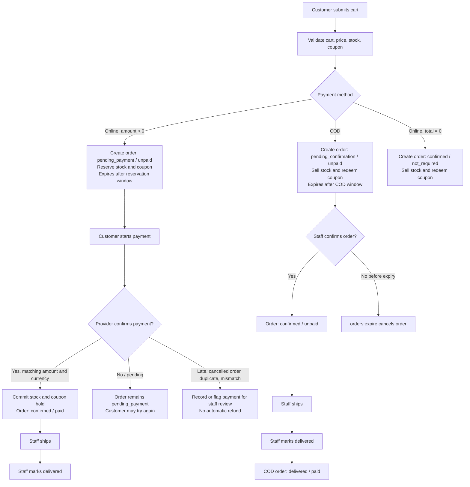
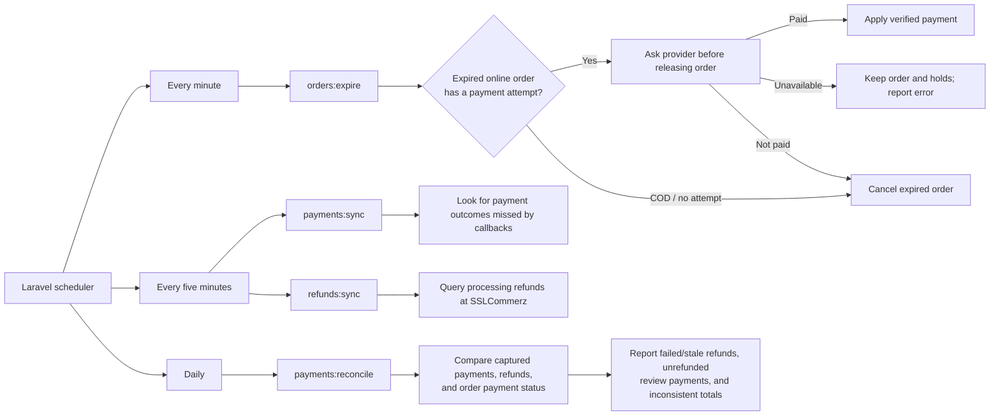

# Orders, Payments, and Refunds

This guide describes the current Laravel implementation. The diagrams use Mermaid; GitHub and many Markdown viewers render them visually.

## 1. Order lifecycle



### Order states at a glance

| Checkout case | Initial order/payment state | Stock and coupon |
|---|---|---|
| Online, payment required | `pending_payment` / `unpaid` | Reserved until payment or cancellation |
| Cash on delivery | `pending_confirmation` / `unpaid` | Stock sold and coupon counted immediately |
| Online, zero total | `confirmed` / `not_required` | Stock sold and coupon counted immediately |
| Staff cancels a paid order | `cancelled` / `refund_pending` while refunds are outstanding, then `partially_refunded` or `refunded` | Stock restored and coupon use released |
| Cancelled order, all captured money returned | `cancelled` / `refunded` | No automatic restock/coupon change after refund success |

Customers may cancel eligible unpaid orders. Staff may cancel orders while their current order status allows it, including a paid confirmed order. A paid-order cancellation requires an explicit `include_delivery_fee` choice. Shipped and delivered orders cannot be cancelled through this workflow.

## 2. Online payment lifecycle

```mermaid
sequenceDiagram
    autonumber
    actor Customer
    participant API as Laravel API
    participant DB as Database
    participant Gateway as SSLCommerz
    participant Queue as Queue worker

    Customer->>API: POST /orders/{number}/pay
    API->>DB: Lock order; verify pending, unpaid, unexpired
    API->>DB: Save initiated payment attempt
    Note over API,DB: Commit before contacting gateway
    API->>Gateway: Start checkout with tran_id and callback URLs
    Gateway-->>API: Checkout URL and session key
    API-->>Customer: Checkout URL
    Customer->>Gateway: Complete payment
    Gateway-->>API: success/fail/cancel callback or IPN
    API->>Gateway: Validate/query transaction server-side
    Note over API,Gateway: Callback fields alone are not proof of payment
    API->>DB: Record provider event once
    alt Payment amount and currency match; order hold is active
        API->>DB: Mark payment succeeded and save paid_amount
        API->>DB: Commit stock/coupon; confirm order as paid
    else Late, duplicate, order already cancelled, or amount mismatch
        API->>DB: Save actual amount and flag for staff review
        Note over API,DB: No automatic refund is initiated
    else Provider reports failure/cancel/expiry
        API->>DB: Close payment attempt
        Note over API,DB: Order stays open until its own expiry
    end
    API-->>Customer: Redirect to configured order page with result
    Note over API,Customer: Unknown payment falls back to PAYMENT_RETURN_URL
    Queue-->>DB: payments:sync checks provider for missed callbacks
```

The configured callback base is the public site origin only; Laravel appends `/api/payments/sslcommerz/{success,fail,cancel,ipn}`. Do not put a frontend path such as `/my-orders` in `SSLCOMMERZ_CALLBACK_BASE`. Successful customer callbacks return to `PAYMENT_FRONTEND_ORDER_URL/{order number}`; unknown payments use `PAYMENT_RETURN_URL`.

## 3. Refund lifecycle

```mermaid
sequenceDiagram
    autonumber
    actor Admin
    actor Staff
    participant API as Laravel API
    participant DB as Database
    participant Queue as Queue worker
    participant Gateway as SSLCommerz

    Admin->>API: POST /admin/payments/{reference}/refunds<br/>amount, reason, idempotency_key
    API->>DB: Lock payment; sum non-failed refunds
    API->>DB: Check amount <= paid_amount - reserved refunds
    API->>DB: Insert refund as pending
    Note over DB,Queue: Enqueue only after commit
    Queue->>DB: Claim pending refund; mark processing
    Queue->>Gateway: Request refund using bank_tran_id and refund reference
    alt Provider confirms success
        Gateway-->>Queue: succeeded + provider refund id
        Queue->>DB: Mark refund succeeded
        Note over DB: Cancelled order becomes partially_refunded if money remains, or refunded if all captured money returned
    else Provider definitively rejects request
        Gateway-->>Queue: failed
        Queue->>DB: Save failure reason
        Admin->>API: Explicitly retry failed refund
    else Timeout or unknown provider outcome
        Gateway--xQueue: No trustworthy outcome
        Note over Queue,DB: Leave processing; never automatically resend
        Scheduler->>Gateway: refunds:sync queries the provider refund reference
        alt Provider has a final status
            Gateway-->>Scheduler: succeeded or failed
            Scheduler->>DB: Save provider status and update cancelled order payment status
        else Provider status is still unknown
            Scheduler-->>Admin: Keep processing; inspect provider before resolving
            Admin->>API: POST /admin/refunds/{id}/resolve after checking provider
        end
    end

    Staff->>API: Cancel paid order + include_delivery_fee choice
    API->>DB: Cancel order, restore stock, release coupon
    API->>DB: Request product refund (delivery excluded by default)
    Note over API,DB: Paid-order cancellation is available to staff; refund requests are saved before gateway work
```

### Refund rules

- A refund belongs to one payment. A duplicate payment can be refunded without changing a confirmed order's `paid` status.
- `paid_amount` is the provider-reported amount actually received. This matters when the received amount differs from the original payment attempt.
- Partial refunds are available through the admin refund endpoint. The payment row is locked while the refundable balance is checked.
- Each request has a unique provider-facing refund reference and an idempotency key unique within its payment.
- Failed refunds may be explicitly retried by an admin. `processing` means the provider outcome is uncertain; `refunds:sync` checks it with SSLCommerz, and an admin may resolve it only after checking the provider.
- Staff cancellation refunds eligible captured payments for products. Delivery is retained unless staff explicitly includes it.
- Late, duplicate, cancelled-order, and amount-mismatch payments are flagged for a person; this workflow does not automatically refund them.
- Customers can see refund amount, reason, and status on their own order. Admins can list and inspect refunds at `GET /admin/refunds` and `GET /admin/refunds/{id}`.

## 4. Expiry and reconciliation



Run both the scheduler (`php artisan schedule:work`, or cron invoking `schedule:run`) and a queue worker (`php artisan queue:work`). Without the queue worker, refunds can remain `pending`; reconciliation reports old queued refunds. Status sync only queries the provider and never resubmits a refund. If the provider outcome remains unknown, an admin must inspect it before using the resolve endpoint.

## 5. Where to look in the code

| Responsibility | Main implementation |
|---|---|
| Checkout, cancellation, fulfillment | [`OrderService`](../app/Services/OrderService.php) |
| Payment initiation and verified provider outcomes | [`PaymentService`](../app/Services/PaymentService.php) |
| SSLCommerz requests and callbacks | [`SslCommerzGateway`](../app/Services/Payments/SslCommerzGateway.php), [`PaymentCallbackController`](../app/Http/Controllers/Api/V1/PaymentCallbackController.php) |
| Refund ledger, balance guard, provider processing and resolution | [`RefundService`](../app/Services/RefundService.php), [`ProcessRefund`](../app/Jobs/ProcessRefund.php), [`AdminRefundController`](../app/Http/Controllers/Api/V1/AdminRefundController.php) |
| Refund status synchronization and payment reconciliation | [`SyncRefunds`](../app/Console/Commands/SyncRefunds.php), [`ReconcilePayments`](../app/Console/Commands/ReconcilePayments.php) |
| Scheduled tasks | [`routes/console.php`](../routes/console.php) |
